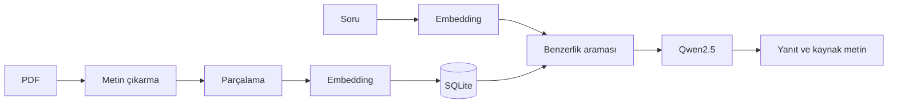

# Yerel İzahname Özetleyicisi

Finansal izahname PDF'lerini kendi bilgisayarınızda sorgulamanızı sağlayan bir RAG (Retrieval-Augmented Generation) uygulaması. PDF'leri yükleyip Türkçe soru sorarsınız; yanıt, dayandığı kaynak metinle birlikte gelir.

## Özellikler

- **Yerel çalışır:** Dil modeli, embedding modeli ve veritabanı kendi cihazınızdadır. API anahtarı gerekmez, belgeleriniz dışarı gönderilmez.
- **Kaynağını gösterir:** Her yanıtın altında, kullanılan izahname bölümleri dosya adıyla birlikte görüntülenir.
- **Belgeye bağlı kalır:** Modele yalnızca bulunan metne göre yanıt vermesi, bilgi yoksa bunu belirtmesi söylenir.
- **Birden fazla PDF:** Aynı anda birkaç izahname yükleyip hepsinde arama yapabilirsiniz.
- **GPU gerekmez:** Dil modeli işlemci üzerinde çalışır.

## Nasıl çalışır?



1. PDF metni 300 karakter örtüşen 1200 karakterlik parçalara bölünür ve her parçaya kaynak dosya adı eklenir.
2. Parçalar vektöre dönüştürülüp SQLite'a kaydedilir.
3. Soru da vektöre çevrilir ve kosinüs benzerliğiyle en yakın iki parça bulunur.
4. Qwen2.5 yanıtı bu iki parçayı kullanarak yazar.

## Kullanılan teknolojiler

| Katman | Araç |
| --- | --- |
| Arayüz | Streamlit |
| Dil modeli | `Qwen/Qwen2.5-0.5B-Instruct` |
| Embedding | `paraphrase-multilingual-MiniLM-L12-v2` |
| Veritabanı | SQLite |
| PDF okuma | PyPDF2 |

## Kurulum

```bash
git clone https://github.com/traldo44/local-rag-project-with-streamlit.git
cd local-rag-project-with-streamlit
python3 -m venv venv
source venv/bin/activate
pip install streamlit transformers torch sentence-transformers PyPDF2 numpy
streamlit run app.py
```

Windows'ta sanal ortamı `venv\Scripts\activate` ile etkinleştirin.

İlk açılışta modeller Hugging Face'ten indirilir (yaklaşık 1,5 GB). Sonraki açılışlarda bilgisayarınızdaki kopya kullanılır.

## Kullanım

1. Sol panelden bir veya daha fazla izahname PDF'i seçin. Denemek için [`docs`](docs) klasöründeki örnekleri kullanabilirsiniz.
2. **İzahnameleri İşle** düğmesine basın.
3. Sorunuzu yazın, örneğin: *"Fonun yönetim ücreti ne kadar?"*
4. Yanıtın altındaki **Eşleşen Kaynak Metinleri Görüntüle** bölümünden kaynağı kontrol edin.

> Belgeleri her işlediğinizde veritabanı sıfırlanır. Birlikte sorgulamak istediğiniz dosyaların hepsini tek seferde yükleyin.

## Sınırlamalar

- Taranmış (görüntü tabanlı) PDF'ler okunamaz; OCR yoktur.
- Küçük bir dil modeli kullanıldığı için yanıtlar hatalı olabilir. Önemli bilgileri kaynak metinden doğrulayın.
- Her soru bağımsız değerlendirilir; önceki mesajlar modele aktarılmaz.

Bu proje yatırım tavsiyesi vermez.
